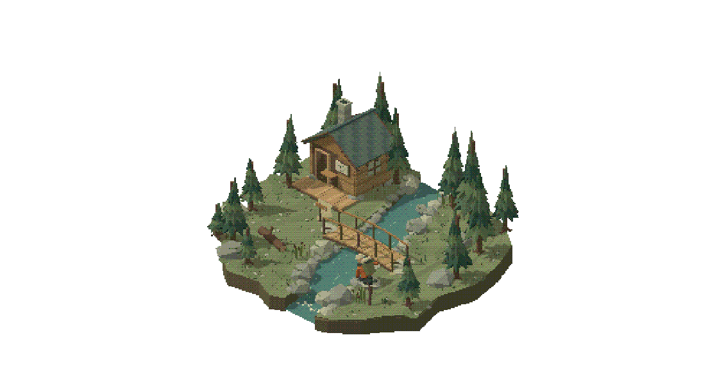
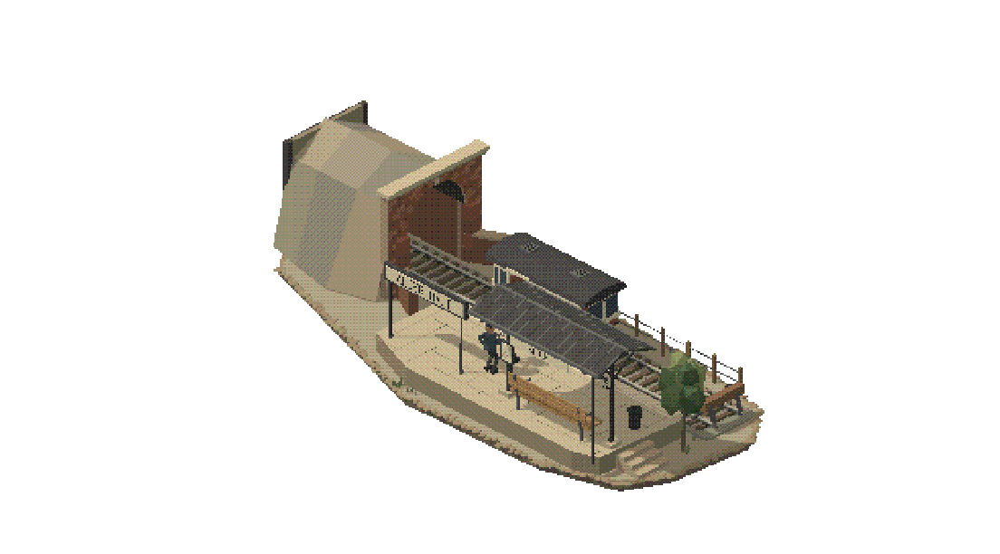
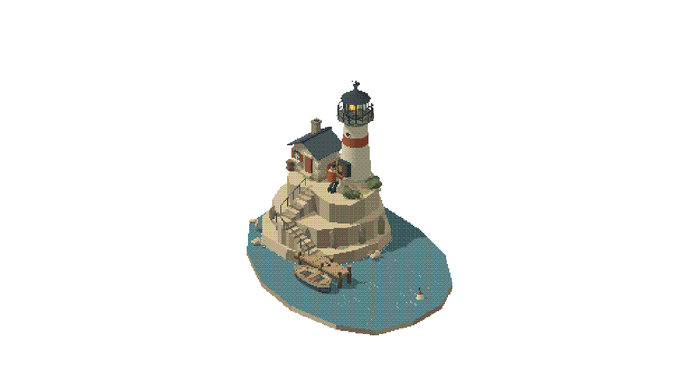

# Reviewed scene adaptations

These are original examples generated while testing this skill on 2026-10-23. They extend the two source references to different subjects; they are not additional work by the reference artists. The reusable part is the rendering language, composition and animation approach. Palette, architecture, terrain and activity belong to each place.

All examples use the bundled Three.js 0.180.0 runtime, a fixed orthographic camera (45-degree azimuth, approximately 30.5-degree elevation), white surround, pixel size 1.8, 9 quantization levels per channel and dither strength 0.85. Each has an authored 45-second timeline, once-and-hold default, seeking, replay, and an optional complete-sequence loop.

## Forest river: Water for the way back

[Scene builder](../assets/demo/forest-river.js) - still frame at 18.7 seconds.

The river divides two irregular banks, and the bridge connects them physically. The cabin anchors the far bank while deliberately spaced pines frame the hiker's route. A visible rock at the near bank gives the canteen-filling action its own clear stage. The finite cut edge explains the terrain without turning it into a generic square display slab.

The palette suits an alpine forest: deep fir and sage for vegetation (`#3a594b`, `#637b5a`, `#758263`), opaque blue-green water (`#4d7e7b`), granite (`#899187`), warm timber (`#9b7b53`), and a small burnt-orange jacket (`#b56941`). Green is dominant because vegetation is dominant in this place. Do not transfer that balance to unrelated architecture.

The nine-beat story covers reading a route map, collecting a canteen, crossing the bridge, refilling, drinking, watching a bird, returning, replacing the canteen and settling. The bottle has explicit hand, mouth, water and shelf contacts. Stream highlights loop independently under the full narrative.

Reviewed at normal display size and through a complete 45-second playback. Browser checks passed for the full visible bounds, deterministic seeking, phase continuity, complete-sequence loop seam and finite ending. Use this example for irregular banks, coherent vegetation, grounded paths and a long prop-based outdoor action.

## Station: Alder Halt

[Scene builder](../assets/demo/station.js) - still frame at 20.95 seconds.

An elongated footprint organizes the scene into a covered tunnel, railway, coping edge, platform, waiting shelter and forecourt. Running-bond brickwork, a stone arch and keystone, iron roof trusses, a gabled canopy, enamel signs, a clock and timber seating establish a built railway setting. The tunnel is actual geometry that conceals the parked train; it supports continuous entry and departure within the miniature's finite boundary.

The material hierarchy is deliberately different from the forest: warm paving (`#bdb19c`), exposed rock (`#b1a28c`), weathered brick (`#946452`), charcoal canopy (`#48494c`), steel (`#626368`), and a restrained maroon-and-cream railcar (`#835452`, `#ddd5bd`). Green appears in sparse planting. Dominant color masses and the physical construction both express the place; using a muted rendering style does not require an olive tint on every material.

The nine-phase story follows an attendant noticing the train, its arrival from the tunnel, a passenger stepping out, presenting a ticket, inspection, boarding, a departure signal, the train's return into the tunnel, and the attendant sitting down. The ticket stays with its holder while the punch reaches its actual surface, avoiding an ownership teleport.

The revised palette and architecture were reviewed in the browser. The complete 45-second sequence was recorded, and all 11 scene checks passed, including bounds, seeking, phase continuity and the full-sequence seam. Use this example for elongated compositions, railway materials, architectural masking and a longer vehicle/character interaction.

## Coast: The winding keeper

[Scene builder](../assets/demo/coastal-lighthouse.js) - still frame at 20 seconds.

An irregular inlet wraps around a stepped sandstone headland. Two connected stairways lead from a small jetty to the keeper's cottage and lighthouse. The tall shaft and lantern give this example a vertical silhouette, while the inlet leaves enough space for the skiff's full oar sweep and turning path. Railings, a winding cabinet, a mooring cleat and a buoy support the activity rather than acting as unrelated decoration.

The palette comes from coastal construction: sandstone (`#b6a88d`, `#c4b79e`), chalk plaster (`#e1dbc8`), slate (`#4c5966`), weathered rust-red details (`#a9634a`), blue sea (`#557f8e`) and paler shallows (`#7899a2`). Sparse wind-shaped planting stays secondary. Warm brass and the lantern's amber light provide small focal details without tinting the whole scene.

The nine-phase story follows rowing in, stowing the oars, landing, climbing, opening and winding the beacon cabinet, closing it, descending, recovering the mooring rope, boarding, rowing out and settling. Hands track the oar grips, crank and latch; the rope changes attachment through a continuous path. Water, buoy and beacon motion are subordinate tracks under the complete story.

The complete 45-second sequence reached every phase, completed once and held its ending. All 11 browser scene checks passed, including the corrected boarding-to-rowing transition, deterministic seeking, full-story bounds and optional loop seam. Use this example for vertical framing, terraced terrain, coherent boat/shore interactions and material choices distinct from the forest and railway.
